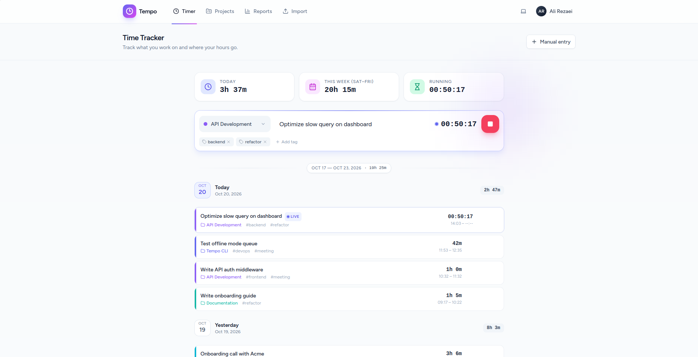
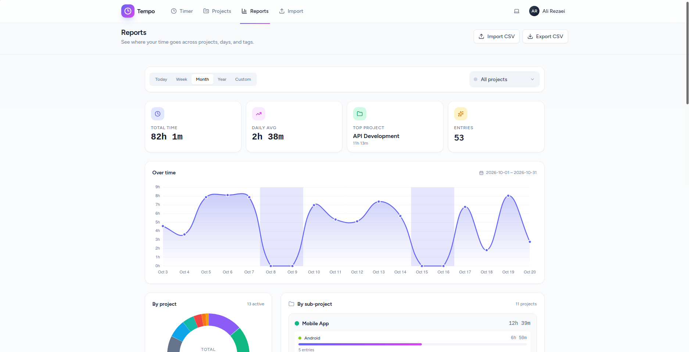
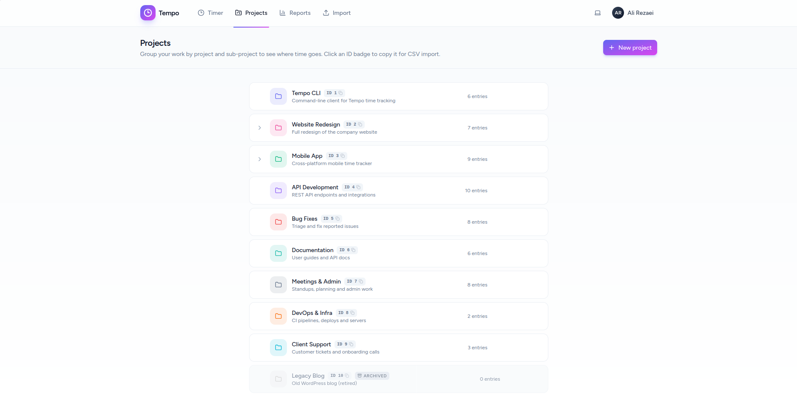
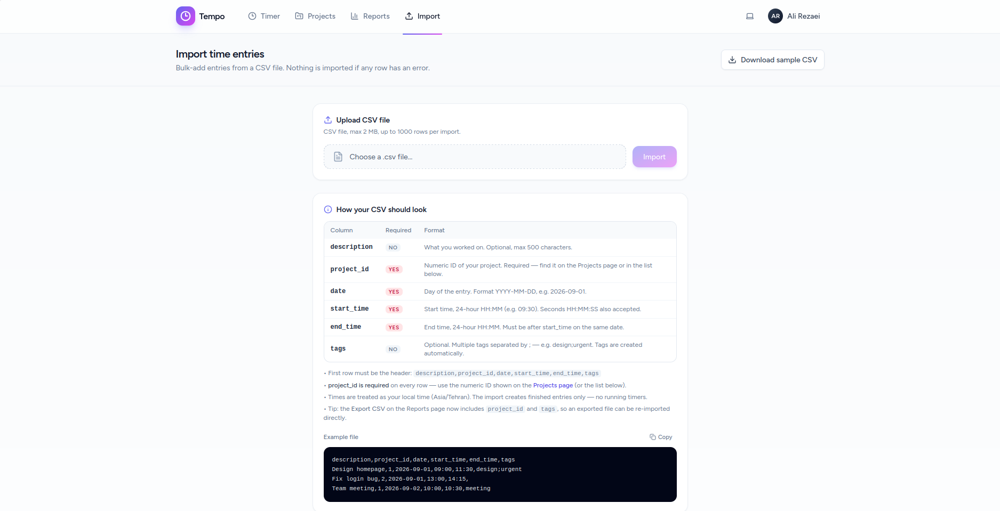
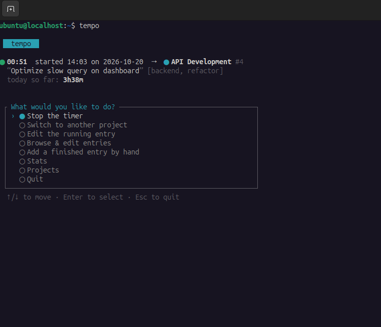
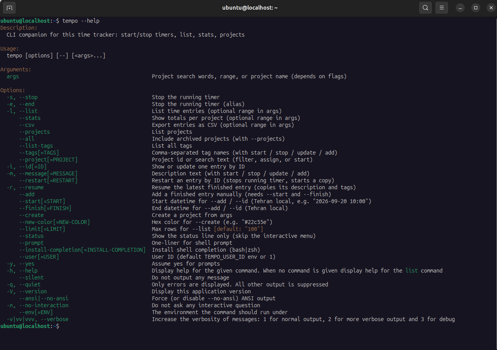

# Tempo

A self-hosted time tracker for one person: a **web app** (Laravel + Inertia + Vue) and a **`tempo` CLI** that share the same database.

Track your work per project, with descriptions and tags. One timer runs at a time — starting a new one stops the previous. Everything you do in the browser is also available from the terminal.

## Features

**Web app**

- Live dashboard: running timer, day/week totals, filter by project or tag
- Projects with sub-projects, colors and archiving
- Manual entries, and CSV import / export
- Reports: totals per project, per date and per tag, with charts
- Everything in Tehran local time (stored as UTC)

**`tempo` CLI**

- Start / stop / switch timers, list entries, stats, CSV export
- Interactive arrow-key menu when you run plain `tempo`
- Fuzzy project search: `tempo sabtivan`
- `tempo -r` resumes your latest session (keeps its description and tags)
- Never deletes anything — the CLI only starts, stops and edits

## Screenshots

**Web app**

| Timer | Reports | Projects |
| --- | --- | --- |
|  |  |  |



**CLI**

| Interactive menu | `tempo --help` |
| --- | --- |
|  |  |

## Requirements

- PHP 8.3+ with the `pdo_mysql` (or `pdo_sqlite`) extension
- Composer 2, Node 20+ and npm
- MySQL 8 (or SQLite)

## Installation

```bash
git clone https://github.com/AmooEbrahim/simple-time-tracker.git
cd simple-time-tracker

composer install
npm install

cp .env.example .env
php artisan key:generate
```

Point the app at your database in `.env` (MySQL by default, SQLite works too):

```env
DB_CONNECTION=mysql
DB_HOST=127.0.0.1
DB_PORT=3306
DB_DATABASE=simple_time_tracker
DB_USERNAME=root
DB_PASSWORD=password
```

Then create the tables and build the frontend:

```bash
php artisan migrate
npm run build

php artisan serve
```

The app is now on <http://127.0.0.1:8000> — register an account on `/register` and start tracking.

For development with hot reload, run `npm run dev` next to `php artisan serve` (or `composer dev` for the whole stack).

## The `tempo` CLI

The CLI lives in the repo root and talks to the same database as the web UI, so anything you track in the browser shows up in the terminal and the other way around.

### Setting it up

The `tempo` file is a small wrapper around `php artisan tempo`. It needs the app to be installed (`.env`, database and `vendor/` ready) — do the [installation](#installation) first.

Put it on your `PATH`:

```bash
cd simple-time-tracker
chmod +x ./tempo
sudo ln -s "$(pwd)/tempo" /usr/local/bin/tempo
```

Or keep it inside the project and call it with `./tempo`:

```bash
./tempo --status
```

Check that it works:

```bash
tempo --status
```

It should print your current timer and today's total.

Optional: shell tab-completion.

```bash
tempo --install-completion bash   # or zsh — restart your shell afterwards
```

### Which user?

The CLI works on a single user, by default the one with ID `1`:

```bash
tempo --user=2 --status        # another user
export TEMPO_USER_ID=2         # or set it once, for every tempo call
```

### Usage

```bash
tempo                  # interactive menu (arrow keys)
tempo sabtivan         # start the "Sabtivan" project timer
tempo -e -m "done"     # stop the running timer and write a note
tempo -r               # resume your latest session
tempo -l today         # list today's entries
tempo --stats week     # totals per project
tempo --csv all        # export everything as CSV
tempo help             # full list of commands
```

Times you type are Tehran local. The CLI never deletes anything.

## Tests

```bash
composer test
```

## License

MIT — see [LICENSE](LICENSE).
